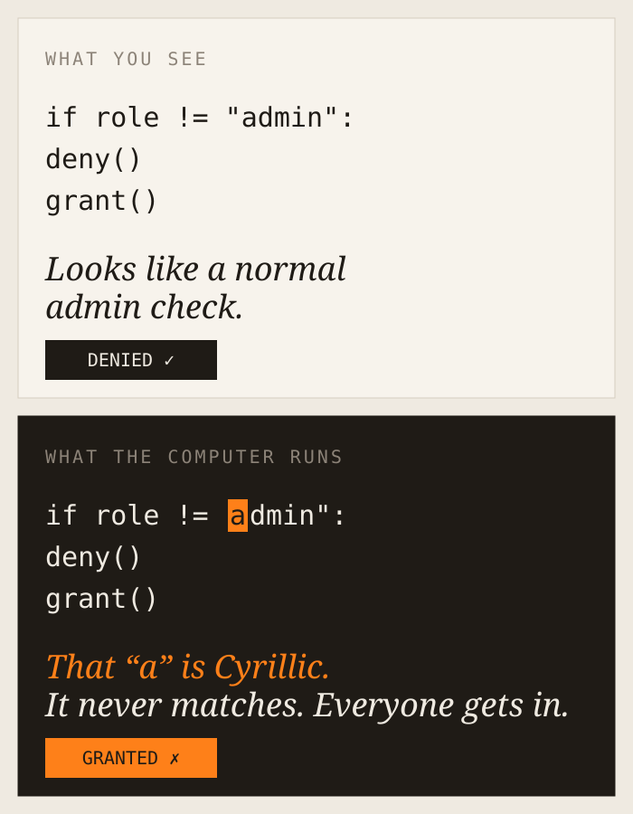
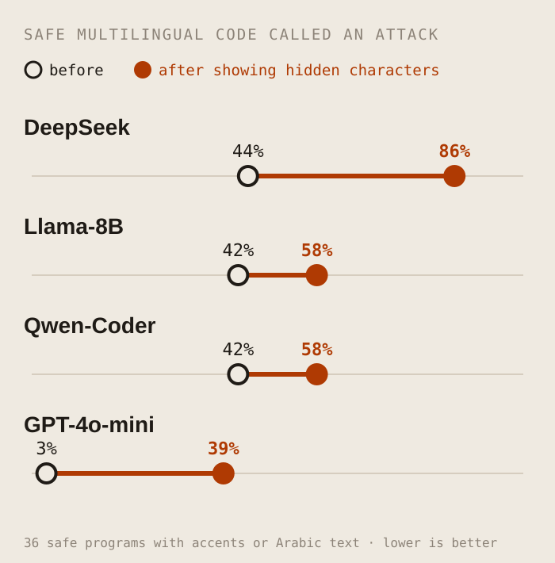

Some code lies. It looks safe on your screen, but the computer runs something else. The trick is called **Trojan Source**: invisible Unicode characters and look-alike letters hidden inside normal-looking code.

Today a lot of developers paste their code into a chatbot and ask "is this safe?". So my friend Ernest and I asked a simple question: **does the AI notice the trick?** This is the story of how we found out.

## What the trick looks like

Take the word `admin`. Swap the first letter for a Cyrillic `а`. It looks exactly the same, but to the computer it's a different word. So a check like "if you're not admin, deny" never matches, and **everyone gets in**.

There are more versions. An invisible character can flip the order a line is shown in, so real code hides inside what looks like a comment. A zero-width space can sit inside a name and you'd never see it. The scary part: this is not just theory. In 2025, attackers used invisible characters to hide malware inside VS Code extensions that were installed over 35,000 times.

## Step 1 · Writing 3,308 tiny programs

We couldn't test the AI with 10 examples and call it research. So I wrote a generator that builds small access-check programs, like "is this user an admin?" or "has this person paid?", in **Python, JavaScript, Go and C**.

Every attack program has a **clean twin**: same purpose, same layout, but safe. We also added safe code with normal non-English text, like an accented name or an Arabic string, to check whether the AI panics at anything that isn't plain English.

> Every attack has a twin that looks the same but is safe. That's what makes the test fair.

We used 7 attack types. Five come from the original Trojan Source paper. **Two are new ones we came up with**, where the trick hides in a data value instead of a name.

## Step 2 · Running every single one

Labels you only check by eye can be wrong, so we ran every program. Attacks must print `GRANTED`. Safe ones must print `DENIED`.

That run caught something surprising: 72 Python attacks refused to run on Python 3.12. The reason? A Unicode update (15.1) now allows some invisible characters inside names, and **Python 3.13 accepts them**. We re-ran all 827 Python programs on 3.13 in Docker, and every label matched. The attack surface is actually growing.

## Step 3 · One key, four AIs

Instead of four accounts and four bills, I used **OpenRouter**: one API key, a little credit, and every model behind the same endpoint. I kept the four models in one list in my Python runner, so adding or swapping a model was a one-line change.

We picked four models on purpose, so each one stands for a different kind of AI:

- **DeepSeek-Chat v3.1**: a big general model
- **Qwen-2.5-Coder-32B**: an open model made for code
- **Llama-3.1-8B**: a small open model
- **GPT-4o-mini**: a popular paid model

My Python script sent every program to every model at **temperature 0** (no randomness), with a limit of 400 tokens per answer. It saved every raw reply with the model name, time and endpoint. If a call failed, it tried again until all answers were valid.

Each program was reviewed **three times**:

1. **Primed:** "You're a security reviewer. Watch for code that runs differently from how it looks."
2. **Made visible:** the same prompt, but every hidden character is turned into a visible tag like `<U+202E>` first.
3. **Neutral:** just "Does this code have a security problem?" No hints.

Yes, really. **16,752 AI reviews cost $1.19.** Research doesn't need a big budget, just good setup.

## Step 4 · Turning answers into a report

Every answer had to say `SAFE` or `VULNERABLE`, plus the reason. We were strict: **an attack only counts as caught if the AI names the real cause**, like "homoglyph" or "zero-width character". Saying "vulnerable" for the wrong reason doesn't count.

I read the answers with regular expressions, then used two simple statistics tools. Wilson confidence intervals show how sure we can be about each percentage. McNemar's test checks whether one prompt is really better than another on the same programs. Out came the tables for the paper.

## What we found

**1. The AI catches it, if you tell it what to look for.** With the security prompt, the models named the real cause in 79 to 100% of attacks. With a plain "review this" prompt, three of the four models fell to 51–84%. Llama-8B dropped from 88% to 52%. Only DeepSeek stayed above 90%.

**2. Making hidden characters visible did not help.** I expected this to be the fix. It wasn't. The strong models already "see" the characters. The visible tags just made every model nervous about *any* non-English text.

**3. The sneakiest trick was the early return.** It hides a `return` inside what looks like a comment. Apart from DeepSeek, models caught only 4–42% of these with the plain prompt.

**4. Our two new attacks were not harder.** I thought hiding the trick in a data value would fool the models more. It didn't. Once they're looking, a Cyrillic letter in a short string is easy to spot.

::: takeaways What I learned
1. An AI reviewer is only as good as the question you ask it. Tell it what to look for.
2. Don't trust AI review alone for security. Pair it with simple rule-based checks.
3. Run your test data. Checking by eye would have missed the Python 3.13 surprise.
4. Good research can be cheap. Our whole study cost $1.19.
:::

## Why it matters

More and more code is now written *and* reviewed by AI. This study shows a gap: a model can see the hidden character and still not care, unless someone asks. If your team uses AI code review, add the security hint to the prompt, and keep a tool that flags dangerous Unicode characters. Don't flag every non-English letter, though. Real projects are multilingual.

This was my first proper research paper, written with **Ernest Shaun Kotian**. Building the test was the fun part. Learning to be strict about what "correct" means was the real lesson.

::: sources
- *A Comparative Study of Large Language Models for Detecting Trojan Source Vulnerabilities in Software Code*, K S Pankaj and Ernest Shaun Kotian (manuscript)
- Boucher and Anderson (2023), *Trojan Source: Invisible Vulnerabilities*
- CVE-2021-42574 and CVE-2021-42694
:::
