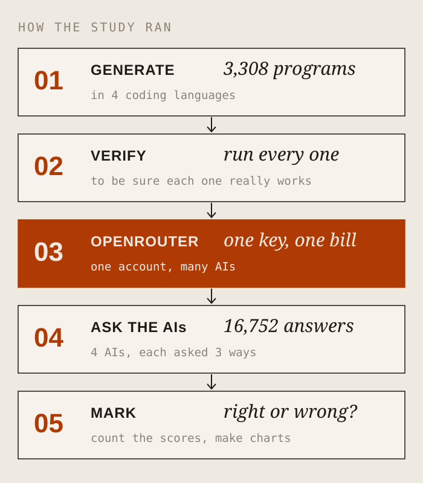
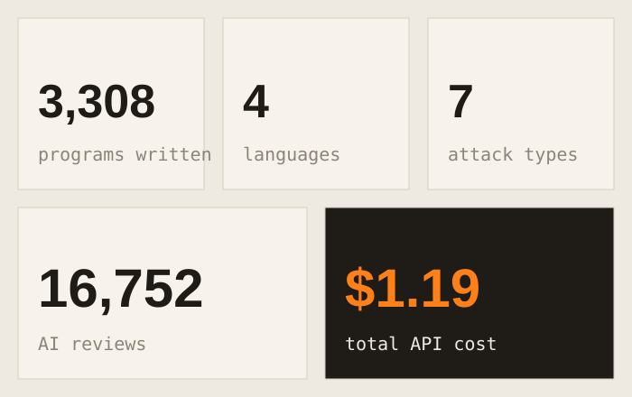
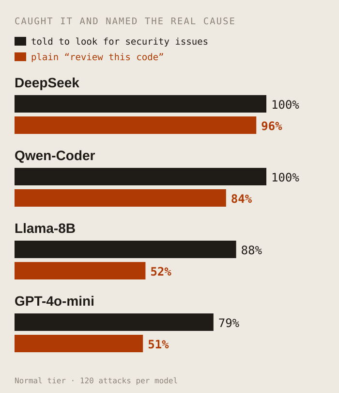

Imagine you get a note from a friend that says "Meet me at 5". But part of the note is written in invisible ink. Under a special light, it actually says "Don't meet me at 5". You read one thing. The truth is something else.

Computer code can play the same trick. This is the story of how my friend Ernest and I tested whether AI can catch it. You don't need to know coding to follow along. I'll explain everything as we go.

## First, what is code?

Code is a list of instructions for a computer, written in a special language like Python. For example: "If this person is an admin, let them in. If not, keep them out." An admin is like the class monitor: the one person who's allowed into the special room.

## And what is an AI like ChatGPT?

Tools like ChatGPT are called **LLMs** (large language models). An LLM is a computer program that has read a huge pile of text from the internet, books and code. From all that reading, it learned to guess what word should come next. It's so good at guessing that it can answer questions, write essays, and even check code for mistakes.

Today a lot of programmers paste their code into an AI and ask: **"Is this safe?"** So we wanted to know: can the AI be fooled?

## The trick: code that lies

The trick is called **Trojan Source**. The name comes from the old story of the Trojan horse: a gift that looked nice but had soldiers hiding inside.

Here's one version. The word `admin` is written with the English letter "a". But there's a Russian letter "а" that looks **exactly** the same. To your eyes, nothing changes. To the computer, it's a completely different word. So the check "keep out anyone who isn't admin" never works, and **everyone gets in**.

There are other versions too:

- **Invisible characters.** There are special letters you literally cannot see. They can sit inside a word without anyone noticing.
- **Flipped text.** Some hidden characters flip the order of text on your screen, so real instructions hide inside what looks like a harmless note.

This isn't just a classroom idea. In 2025, attackers used invisible characters to hide harmful code inside add-ons for VS Code (a popular app programmers use). Over 35,000 people installed them.

## Step 1 · Making 3,308 test programs

To test the AIs properly, a few examples aren't enough. So I wrote a program that **makes other programs**. It created 3,308 small programs, each one doing a simple check like "is this person an admin?" or "has this person paid?".

They're written in 4 coding languages: Python, JavaScript, Go and C. That's like testing the same idea in English, Hindi, Kannada and Tamil.

Here's the clever part. **Every tricky program has a twin** that looks the same but is honest. If the AI shouts "danger!" at both twins, it isn't really smart. It's just nervous. We also added honest programs with normal non-English words, like a name with an accent or a line of Arabic, to see if the AI panics at anything unusual.

> Every trick has an honest twin. That's what makes the test fair.

We used 7 kinds of tricks. Five come from the scientists who first discovered Trojan Source. **Two are brand new ones we invented.**

## Step 2 · Checking every program really works

Before testing the AIs, I ran all 3,308 programs to be 100% sure. Every tricky one had to wrongly let the person in. Every honest one had to correctly keep them out.

This step taught me something surprising. 72 of the tricky Python programs didn't work on the older Python (version 3.12), but **they did work on the newer one (3.13)**. In 2023, the world's rulebook for letters and symbols (called Unicode) changed, and newer Python accepts more hidden characters. In simple words: **this trick is getting easier, not harder.**

## Step 3 · One account, four AIs

Each AI company normally wants its own account and its own bill. Instead, I used a website called **OpenRouter**. Think of it as **one remote control for many AIs**. I added a small amount of money to one account, and could talk to all four AIs through it.

These were the four AIs I tested, each a different "type":

- **DeepSeek**: a big, smart all-rounder
- **Qwen Coder**: free to download, and trained especially on code
- **Llama 8B**: a small, free one (small AIs are cheaper but usually less clever)
- **GPT-4o mini**: a popular paid one, from the makers of ChatGPT

My Python script sent every program to every AI. I set the AIs to "no guessing" mode (called temperature 0), so the same question always gets the same answer, which makes the test fair. The script saved every single answer, so nothing could be changed later.

## Step 4 · Asking in three different ways

Each AI looked at each program **three times**, with a different question each time:

1. **The hint:** "You're a security checker. Watch out for code that looks different from what it does."
2. **The highlighter:** the same hint, but first I made all the invisible characters visible, like using a highlighter on hidden ink.
3. **The plain question:** just "Is there a security problem in this code?" No hints at all.

Adding it all up, the AIs gave us **16,752 answers** to mark.

And yes, the whole thing cost **$1.19**, about ₹100. Good research doesn't always need lots of money. It needs a careful plan.

## Step 5 · Marking the answers like a teacher

Every answer had to say "SAFE" or "NOT SAFE" and explain why. We marked them strictly, like a strict teacher: **the AI only got the mark if it gave the right reason**. Saying "not safe" for the wrong reason is like getting the right answer in maths by copying. No marks.

Then we counted the scores and turned them into charts. We also used some maths to check that the differences were real and not just luck.

## What we found

**1. AI catches the trick, but only if you ask the right way.** With the hint, the AIs caught 79% to 100% of the tricks. With the plain question, three of the four dropped a lot. Llama fell from 88% to just 52%, which is barely better than flipping a coin. Only DeepSeek stayed strong (96%).

**2. The highlighter idea backfired.** I expected that making hidden characters visible would help. It didn't. The smart AIs could already "see" them. Instead, the highlights made every AI nervous about **any** unusual letter, so they started calling honest code "dangerous".

**3. The sneakiest trick was hiding an instruction inside a note.** Programmers leave notes inside code for other people to read. The computer is supposed to skip them. One trick makes a real instruction look like part of a note. Apart from DeepSeek, the AIs caught it only 4% to 42% of the time when asked plainly.

**4. Our two new tricks weren't harder to catch.** I thought they would fool the AIs more. They didn't. Once the AI is paying attention, a fake letter in a short word is easy to spot.

::: takeaways What I learned
1. An AI is only as good as the question you ask it. Tell it exactly what to look for.
2. Don't trust AI alone to keep code safe. Use a simple scanner tool too.
3. Always test your test. Running every program caught a surprise I'd have missed.
4. Big ideas can be cheap. This whole study cost less than a pizza.
:::

## Why this matters

More and more code is now written by AI **and** checked by AI. Our study shows a gap: an AI can notice the hidden character and still not warn you, unless you ask the right question. So if your team uses AI to check code, give it clear instructions, and keep a simple tool that flags hidden characters.

This was my first real research paper, written with **Ernest Shaun Kotian**. Building the test was the fun part. The real lesson was learning to be strict about what "correct" actually means.

::: sources
- *A Comparative Study of Large Language Models for Detecting Trojan Source Vulnerabilities in Software Code*, K S Pankaj and Ernest Shaun Kotian (manuscript)
- Boucher and Anderson, *Trojan Source: Invisible Vulnerabilities* (the scientists who first found the trick)
:::
